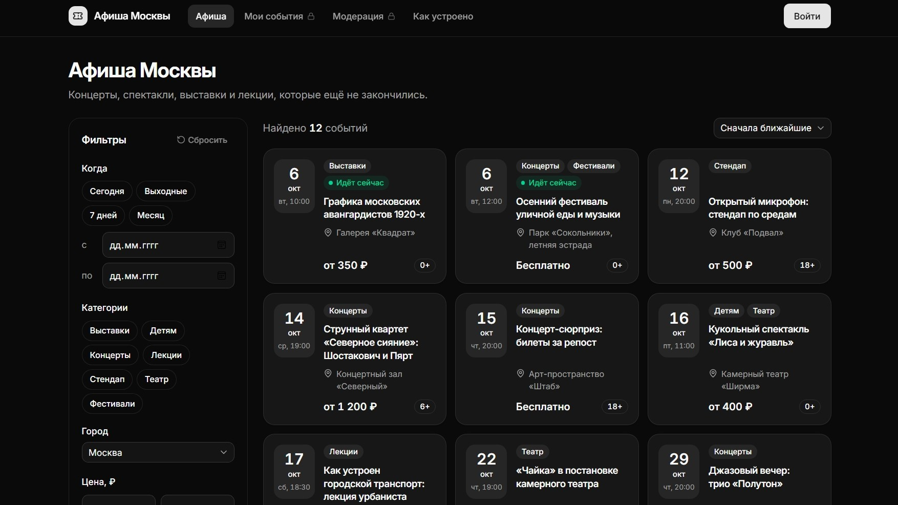

# Афиша API

Афиша событий одного города. Посетители ищут концерты, спектакли и выставки, организаторы ведут свои карточки, модераторы скрывают нарушения.

**Стек:** NestJS 12 · Prisma 7 · PostgreSQL 18 · React 19 · Vite · TanStack Query · React Router 7 · Tailwind 4 · shadcn/ui · Vitest

Vercel - https://afisha-events-7jtyt45h9-donnymo.vercel.app/



## Возможности

- Публичная афиша с фильтрами по датам, категориям, городу и цене, сортировкой и пагинацией
- Кабинет организатора: черновики, проверка готовности, публикация
- Модерация: скрытие карточки с обязательной причиной
- JWT-аутентификация и роли `organizer` / `moderator`
- Единый формат ошибок с `requestId` и OpenAPI-документация

## Запуск

Нужны Node.js 22+ и Docker.

```bash
npm install
cp .env.example .env   # задать JWT_SECRET не короче 32 символов
npm run db:up          # PostgreSQL в Docker на порту 5433
npm run db:deploy      # миграции
npm run db:seed        # демо-данные
npm run dev            # API :3000, сайт :5173
```

- Сайт: http://localhost:5173
- Swagger UI: http://localhost:3000/docs

Демо-аккаунты: `organizer@afisha.local` и `moderator@afisha.local`, пароль `demo-pass-2026` (только для локальной разработки).

## API

| Метод и путь                    | Доступ    | Назначение                                     |
| ------------------------------- | --------- | ---------------------------------------------- |
| `POST /auth/register`, `/login` | все       | Регистрация организатора и вход, выдают JWT    |
| `GET /auth/me`                  | с токеном | Текущий пользователь                           |
| `GET /events`                   | все       | Публичная афиша: фильтры, сортировка, страницы |
| `GET /events/:id`               | все       | Карточка; владелец и модератор видят любую     |
| `GET /events/mine`              | organizer | Свои события, включая черновики и архив        |
| `GET /events/mine/counts`       | organizer | Счётчики своих событий по статусам             |
| `POST /events`, `PATCH /:id`    | organizer | Создать черновик, изменить своё событие        |
| `POST /events/:id/publish`      | organizer | `draft → published`                            |
| `GET /events/moderation`        | moderator | Очередь модерации                              |
| `GET /events/moderation/counts` | moderator | Размер очереди по статусам                     |
| `POST /events/:id/hide`         | moderator | `published → hidden` с причиной                |
| `GET /categories`, `/venues`    | все       | Справочники; `POST /venues` — с токеном        |

Как устроено:

- **Модули NestJS** (`auth`, `events`, `venues`, `catalog`): controller, service, dto. Доступ к базе через Prisma, конфиг из окружения проверяется при старте.
- **Доступ** проверяется в три слоя: глобальный `JwtAuthGuard` (401), `RolesGuard` по `@Roles()` (403) и проверка владельца в сервисе. Чужой черновик при чтении отдаёт 404, чтобы не раскрывать его существование.
- **Валидация**: DTO на `class-validator`. Лишние поля запрещены, поэтому статус нельзя поменять через `PATCH`, а опечатка в фильтре даёт 400, а не пустую выдачу.
- **Статус события** меняется только командами `publish` и `hide`. Переход атомарный (`updateMany … where status = ожидаемый`), так что гонка с модератором заканчивается 409, а не перезаписью.
- **Выдача**: offset-пагинация (`page`, `pageSize` ≤ 50) со стабильной сортировкой. Публика видит только опубликованные и ещё не закончившиеся события.
- **Ошибки** любого вида приходят в одном формате: `{ code, message, details, requestId }`. `requestId` совпадает с заголовком `X-Request-Id`.
- **Пароли** хранятся как scrypt-хеш с солью. Вход и регистрация ограничены по IP и по email (429).
- **Архив**: закончившиеся события фоновая задача переводит из `published` в `archived`, чтобы выборки не росли с историей.


Полное описание маршрутов — в Swagger UI и в `openapi.json`.

## Скрипты

| Команда             | Что делает                                      |
| ------------------- | ----------------------------------------------- |
| `npm run dev`       | API и фронтенд в режиме разработки              |
| `npm run build`     | Сборка API (`dist/server`) и сайта (`dist/web`) |
| `npm test`          | Unit- и интеграционные тесты                    |
| `npm run test:unit` | Только unit-тесты, база не нужна                |
| `npm run check`     | Проверка типов, линтер и форматирование         |
| `npm run openapi`   | Обновить `openapi.json`                         |
